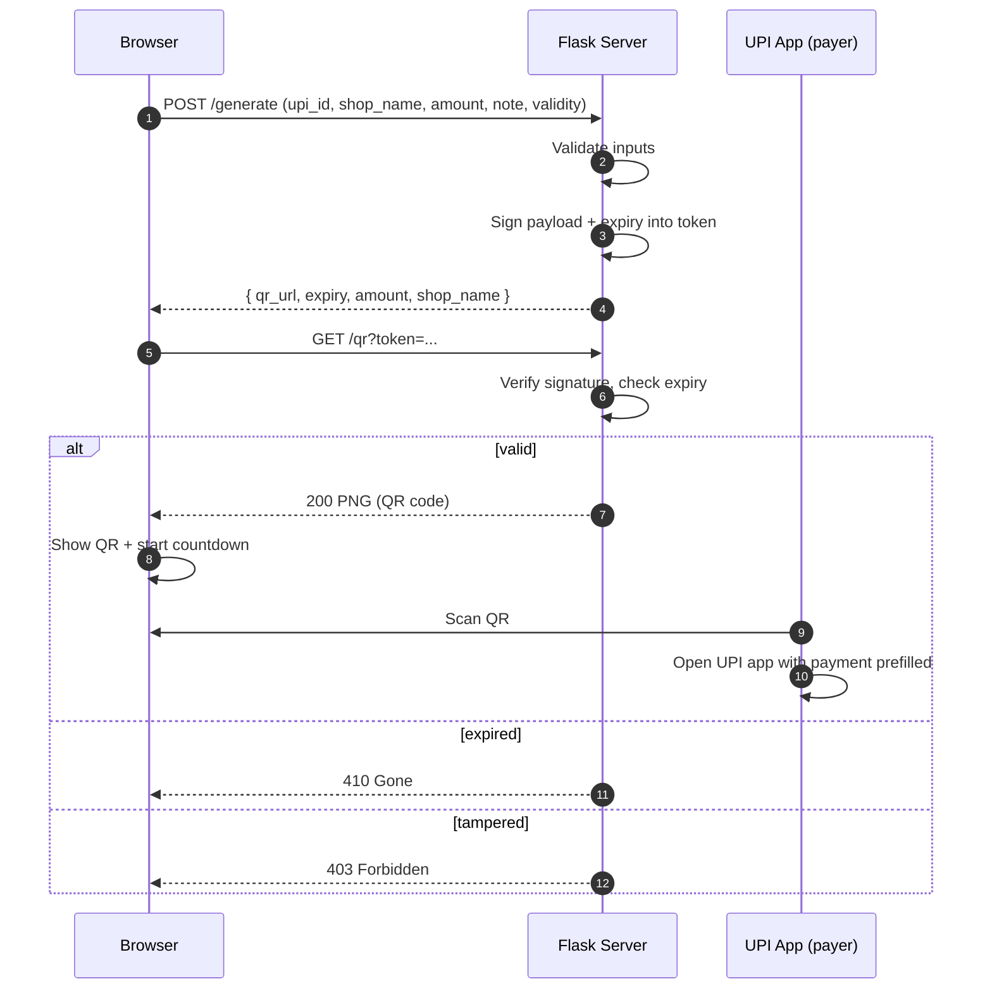

<div align="center">

# 💸 Py-UPI

### Signed, expiring UPI payment QR codes — built with Flask


Generate a UPI payment QR for a fixed amount, show it with a live countdown,<br>
and have the server refuse to serve it once it expires.

</div>

---

## 📖 Table of Contents

- [Overview](#-overview)
- [Features](#-features)
- [Architecture](#-architecture)
- [Quick Start](#-quick-start)
- [Configuration](#-configuration)
- [Usage](#-usage)
- [API Reference](#-api-reference)
- [Validation Rules](#-validation-rules)
- [How It Works](#-how-it-works)
- [Security Model](#-security-model)
- [Limitations](#%EF%B8%8F-limitations)
- [Project Structure](#-project-structure)
- [Production Checklist](#-production-checklist)
- [Roadmap Ideas](#-roadmap-ideas)

---

## 🔎 Overview

**Py-UPI** is a small Flask web app for shopkeepers, freelancers and learners who want to
create a **UPI payment QR** quickly. You enter your UPI ID, business name, amount, an optional
note and a validity window. The app returns a QR code that any UPI app (Google Pay, PhonePe,
Paytm, BHIM, etc.) can scan, along with a countdown showing how long it stays valid.

The expiry is checked **on the server** as well as in the browser, so a copied QR image URL
stops working once the timer runs out.

> ⚠️ This is a demo. It generates QR codes but does **not** process or verify payments.
> Read [Limitations](#%EF%B8%8F-limitations) before using it for anything real.

---

## ✨ Features

| Feature | Details |
|---|---|
| **Standards-based UPI link** | Builds a `upi://pay` deep link with payee address, name, amount, currency (`INR`) and note. |
| **Signed tokens** | Payment details are packed into a token signed with `itsdangerous`, so the browser can't alter the amount or payee. |
| **Expiring QR** | Validity is configurable from **30 seconds to 60 minutes** (default 5 minutes). |
| **Live countdown** | The page shows a timer and swaps the QR for **"QR Expired"** at zero. |
| **Server-side enforcement** | `/qr` returns **HTTP 410 Gone** for expired tokens and **403 Forbidden** for tampered ones. |
| **Input validation** | UPI ID format, amount range, note length and required fields are all checked server-side. |
| **No database** | Stateless by design: everything needed lives inside the signed token. |
| **Error-corrected QR** | Level **M** error correction (~15% recovery) for reliable scanning. |
| **No caching** | QR responses are sent with `max_age=0` so stale images aren't reused. |

---

## 🧩 Architecture



---

## 🚀 Quick Start

**Requirements:** Python 3.9+ and `pip`.

```bash
# 1. Clone the repository
git clone https://github.com/SpicychieF05/Py-UPI.git
cd Py-UPI

# 2. Create a virtual environment
python -m venv .venv

# 3. Activate it
# Windows (PowerShell)
.venv\Scripts\Activate.ps1
# macOS / Linux
source .venv/bin/activate

# 4. Install dependencies
pip install -r requirements.txt

# 5. Run the app
python app.py
```

Open **http://127.0.0.1:5000** in your browser.

### Dependencies

| Package | Purpose |
|---|---|
| `Flask >= 3.0.0` | Web framework and routing |
| `qrcode[pil] >= 7.4.2` | QR code generation |
| `Pillow >= 10.0.0` | PNG rendering for the QR image |
| `itsdangerous >= 2.1.2` | Signing and verifying tokens |

---

## ⚙️ Configuration

The only value set in code is the signing key, at the top of `app.py`:

```python
SECRET_KEY = "change-this-secret-key-before-deploying"
```

**Change it before deploying.** Anyone who knows the key can forge valid tokens (see
[Security Model](#-security-model)). Generate a strong one with:

```bash
python -c "import secrets; print(secrets.token_hex(32))"
```

> Your **UPI ID is not configured in code**. You type it into the form each time, and the
> server validates it.

---

## 🖥️ Usage

1. Open the dashboard.
2. Fill in:
   - **UPI ID** — e.g. `yourname@upi`
   - **Shop / business name** — shown to the payer in their UPI app
   - **Amount** — in INR
   - **Note** *(optional)* — up to 50 characters
   - **Validity** — how long the QR should stay valid
3. Click **Generate QR**.
4. Show the QR to the payer and let them scan it with any UPI app.
5. Watch the countdown. At zero, the QR is replaced by **"QR Expired"**.

---

## 📡 API Reference

The UI uses three routes, and you can call them directly.

### `GET /`
Serves the dashboard (`templates/index.html`).

### `POST /generate`
Validates input and returns a signed QR URL.

**Request body** (JSON)

| Field | Type | Required | Notes |
|---|---|---|---|
| `upi_id` | string | ✅ | Must match `username@handle` |
| `shop_name` | string | ✅ | Non-empty |
| `amount` | number | ✅ | `0.01` to `100000`, rounded to 2 decimals |
| `note` | string | ❌ | Max 50 characters (`message` is accepted as an alias) |
| `validity_seconds` | integer | ❌ | `30` to `3600`, default `300` (`validity` is accepted as an alias) |

**Success response** — `200 OK`

```json
{
  "qr_url": "/qr?token=eyJ1cGlfaWQiOi4uLn0.Zx...",
  "expiry": 1792334400,
  "amount": 250.0,
  "shop_name": "Sunrise Stores"
}
```

`expiry` is a Unix timestamp in seconds.

**Error response** — `400 Bad Request`

```json
{ "error": "Amount must be between ₹0.01 and ₹1,00,000." }
```

**Example with curl**

```bash
curl -X POST http://127.0.0.1:5000/generate \
  -H "Content-Type: application/json" \
  -d '{
        "upi_id": "yourname@upi",
        "shop_name": "Sunrise Stores",
        "amount": 250,
        "note": "Order 1042",
        "validity_seconds": 300
      }'
```

### `GET /qr?token=<token>`
Returns the QR code as a PNG.

| Status | Meaning |
|---|---|
| `200` | Valid token. Body is `image/png`. |
| `403` | Signature invalid. The token was tampered with or signed with a different key. |
| `410` | Token is valid but expired. |

---

## ✅ Validation Rules

| Input | Rule |
|---|---|
| UPI ID | Regex: `^[a-zA-Z0-9.\-_]{2,256}@[a-zA-Z]{2,64}$` |
| Amount | Numeric, greater than 0 and at most ₹1,00,000, rounded to 2 decimal places |
| Validity | Whole number of seconds, 30 to 3600 |
| Note | At most 50 characters |
| Shop name | Required, cannot be empty |

---

## 🔬 How It Works

### 1. The UPI deep link
The server builds a link following the UPI payment URI scheme:

```
upi://pay?pa=<payee UPI ID>&pn=<shop name>&am=<amount>&cu=INR&tn=<note>
```

| Param | Meaning |
|---|---|
| `pa` | Payee address (your UPI ID) |
| `pn` | Payee name |
| `am` | Amount, formatted to 2 decimals |
| `cu` | Currency, fixed to `INR` |
| `tn` | Transaction note |

Values are URL-encoded, so spaces and special characters in names and notes are safe.

### 2. The signed token
After validation, the server serializes this payload and signs it with
`URLSafeSerializer` (salt: `py-upi-qr`):

```json
{ "upi_id": "...", "amount": 250.0, "note": "...", "shop_name": "...", "expiry": 1792334400 }
```

The token goes into the `/qr` URL. Changing any character, such as the amount, breaks the
signature and the server responds with `403`.

### 3. QR rendering
When `/qr` is requested, the server verifies the signature, checks the current time against
`expiry`, rebuilds the UPI link and renders a PNG: error correction level **M**, box size 10,
border 4, dark `#0D0D0D` modules on a warm `#F2EEE9` background.

### 4. Expiry on both sides
- **Browser:** a countdown hides the QR and shows "QR Expired" at zero.
- **Server:** `/qr` returns `410 Gone` after `expiry`, so reopening a saved image URL fails.

---

## 🔐 Security Model

**What the design protects against**
- **Tampering:** amount, payee and expiry can't be changed without invalidating the signature.
- **Reusing an old QR URL:** the server refuses to serve expired tokens.

**What it does not do**
- **Tokens are signed, not encrypted.** `URLSafeSerializer` produces a readable (base64) payload, so
  anyone holding a token can decode the UPI ID, amount, name and note. They just can't change them.
- **There are no accounts or authentication.** Anyone who can reach the server can generate QR codes.
- **The signing key is hardcoded** in `app.py`. If it leaks, tokens can be forged.

---

## ⚠️ Limitations

> **Expiry is not enforced by UPI.** The UPI protocol has no concept of an expiring static QR.
> Someone who scanned the QR *before* it expired can still finish the payment after the timer
> ends. The expiry only controls whether *this page and server* keep showing the QR.
>
> **Payments are not detected.** There is no payment gateway, webhook or callback, so the app
> can't tell whether a payment was made, failed or is pending.

If you need real payment confirmation or enforced expiry, use a payment gateway that supports
dynamic QR codes and webhooks (for example Razorpay, Cashfree or PhonePe PG).

---

## 📁 Project Structure

```
Py-UPI/
├── app.py              # Flask app: routes, validation, token signing, QR generation
├── requirements.txt    # Python dependencies
├── templates/
│   └── index.html      # Dashboard UI (form, QR display, countdown)
└── README.md
```

---

## 🛡️ Production Checklist

Before putting this anywhere public:

- [ ] Replace `SECRET_KEY` with a strong random value, ideally loaded from an environment variable
- [ ] Remove `debug=True` from `app.run(...)`
- [ ] Serve with a production server (`gunicorn` / `waitress`) behind HTTPS
- [ ] Add authentication so strangers can't generate QR codes on your server
- [ ] Add rate limiting on `/generate`
- [ ] Add `.venv/` and `__pycache__/` to `.gitignore`

---

## 🗺️ Roadmap Ideas

These are suggestions, not implemented features:

- Load `SECRET_KEY` from environment variables
- Download / print button for the generated QR
- Payment confirmation via a gateway webhook
- Dockerfile for one-command deployment
- Unit tests for validation and token expiry

---

<div align="center">

Built with Flask, `qrcode` and `itsdangerous`.<br>
Found a bug or have an idea? Open an issue or a pull request. 🙌

</div>